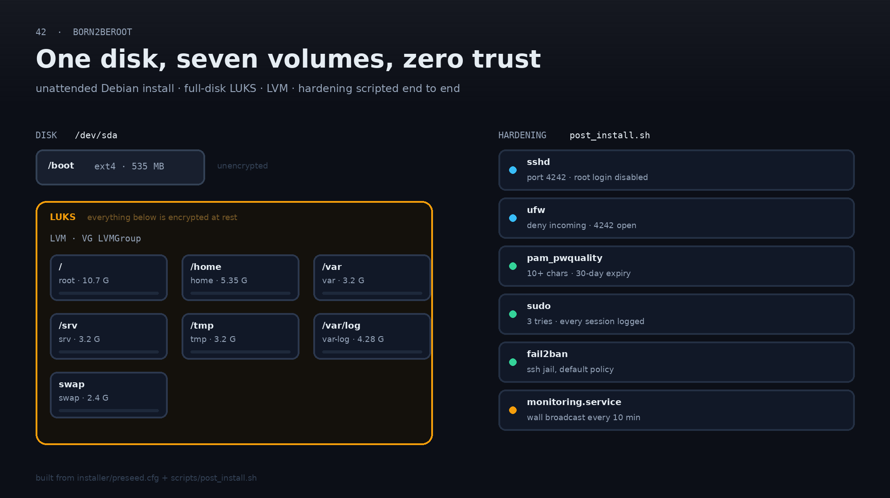
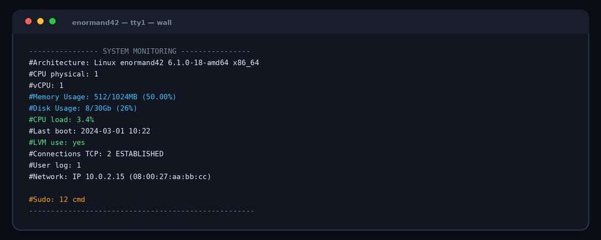

<div align="center">

# Born2beroot

*Build a Debian VM the way the security team would: encrypted disk, closed ports, logs nobody can quietly edit.*




</div>

The repo rebuilds the ISO, one boot installs the machine, and nothing is left to a
click-through wizard: partitioning, encryption, packages and every security setting are in
the repo. The result is a Debian box that only accepts SSH on port 4242, records every
`sudo`, and shouts its own metrics onto every open terminal every ten minutes.

## What the disk looks like

`/boot` sits outside the encrypted container (the bootloader has to read it), everything
else is LUKS, and inside it a single LVM group is cut into six filesystems plus swap — each
with a size chosen on purpose:

| Volume | Filesystem | Size | Why separate |
|---|---|---:|---|
| `/` | XFS | 10.7 G | the rest of the system |
| `/home` | XFS | 5.35 G | user data, no `noexec` headaches |
| `/var` | XFS | 3.2 G | logs and databases go here, not on `/` |
| `/srv` | XFS | 3.2 G | served content |
| `/tmp` | XFS | 3.2 G | the one everyone forgets |
| `/var/log` | XFS | 4.28 G | logs survive a full `/` |
| `swap` | swap | 2.4 G | room to breathe on a small disk |

## The perimeter

| Layer | Setting |
|---|---|
| **SSH** | port `4242`, `PermitRootLogin no`, config checked with `sshd -t` before restart |
| **Firewall** | UFW default deny incoming, only `4242` opened |
| **Passwords** | `pam_pwquality`: 10+ chars, upper/lower/digit required, 3 repeats max, 7 chars different |
| **Aging** | 30-day maximum, 2-day minimum, 7-day warning |
| **sudo** | 3 attempts, custom failure message, full I/O logging under `/var/log/sudo`, TTY required |
| **Brute force** | fail2ban on the SSH jail |
| **Audit trail** | `visudo -cf` validates the sudoers drop-in before it is kept |

## What the machine says about itself



`monitoring.sh` is a systemd service (`Restart=always`) that pipes this summary into `wall`
every 600 seconds. Architecture, cores, memory, disk, load, boot time, LVM, established
TCP connections, logged-in users, IP/MAC and the number of `sudo` commands — all computed
from `/proc`, `df`, `ss` and `journalctl`, no extra agent.

## Building the VM

The brief asks for a hardened Debian machine, not a reproducible installer. Rebuilding
the ISO was my addition, and, as far as I know, the only self-built ISO in my cohort.

It earns its keep. A hand-installed VM is a one-off; this one is a build artifact.
The disk layout, LUKS container, LVM volumes, users and package set cannot drift
between attempts because nobody clicks through a wizard. A wrong setting is a
one-line preseed change and a fresh boot, and anyone can read how the machine was
made instead of trusting a shell history.

The preseed drives Debian's installer, so the whole install is reproducible:

```bash
# 1. unpack a Debian netinst ISO
xorriso -osirrox on -indev debian.iso -extract / iso

# 2. drop the preseed and scripts in, repack
cp installer/*.cfg iso/ && cp scripts/*.sh iso/
xorriso -as mkisofs -o born2beroot.iso -isohybrid-mbr /usr/lib/ISOLINUX/isohdpfx.bin \
  -c isolinux/boot.cat -b isolinux/isolinux.bin -no-emul-boot -boot-load-size 4 \
  -boot-info-table -eltorito-alt-boot -e boot/grub/efi.img -no-emul-boot \
  -isohybrid-gpt-basdat iso

# 3. new VM, 30 GB disk, boot the ISO, walk away
```

Replace the `CHANGE ME` values (passwords, LUKS passphrase, mirror suite) first. The
preseed calls `post_install.sh` in the target system at the end of the install; the script
is idempotent, so it can be re-run on a live machine.

## Notes

- The recipe targets BIOS/legacy boot on a single `/dev/sda`; UEFI needs a different
  partitioning stanza.
- `mirror/suite` is pinned to `bookworm` — match it to the ISO you download.
- There is no container version of this: it is a disk, a bootloader and a kernel, so it
  wants a VM.

## Layout

```text
installer/preseed.cfg      unattended Debian install (LUKS, LVM, packages, late_command)
installer/isolinux.cfg     boot menu entry point
installer/menu.cfg         installer menu
installer/txt.cfg          automated install entry
scripts/post_install.sh    SSH, UFW, PAM, sudo, fail2ban, monitoring service
scripts/monitoring.sh      the wall broadcast above
docs/                      diagram and terminal card
```

## Credits

42 Paris, by [@edouwarden](https://github.com/edouwarden).
